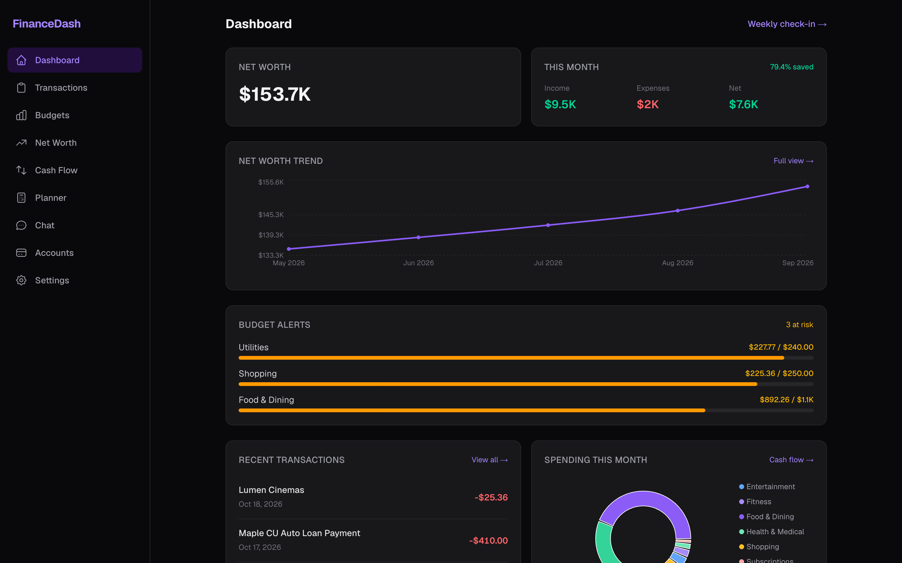
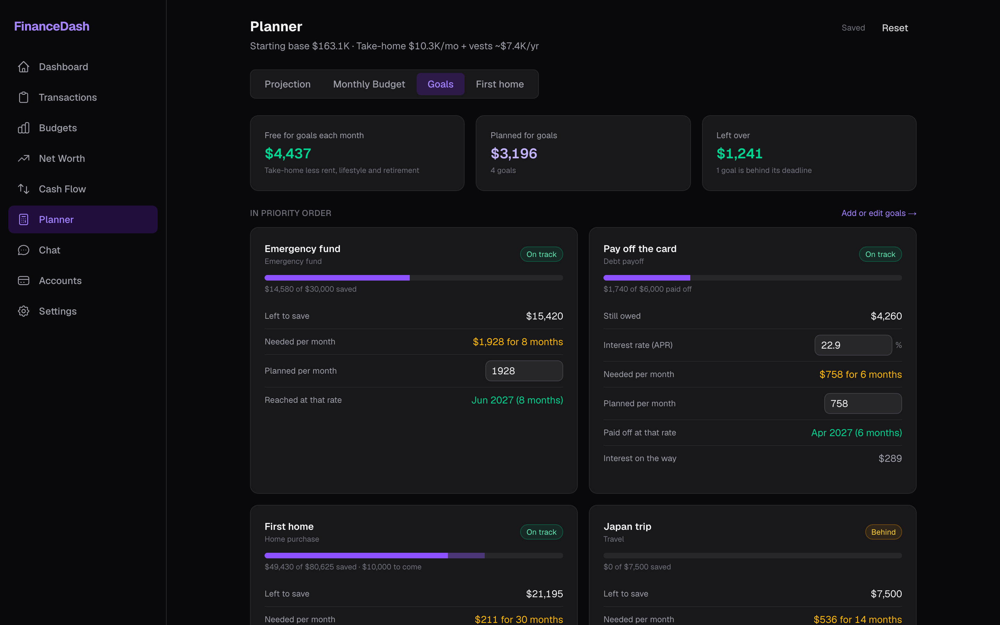
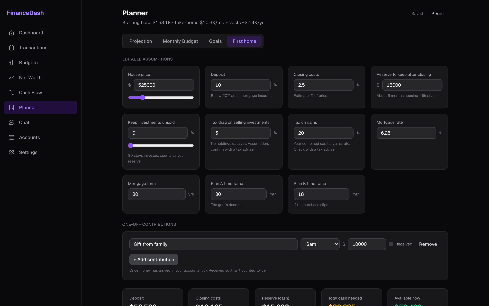
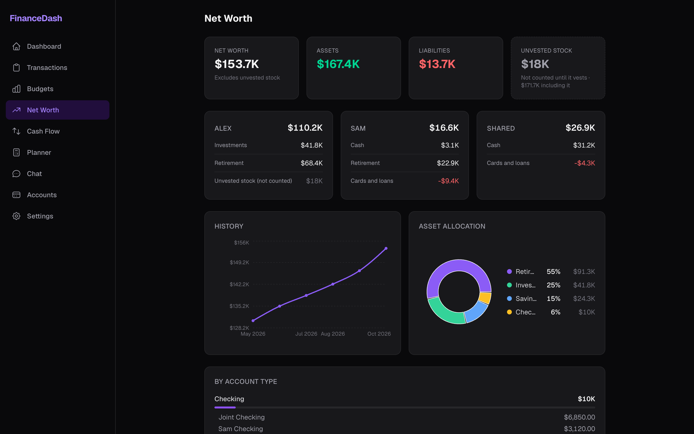
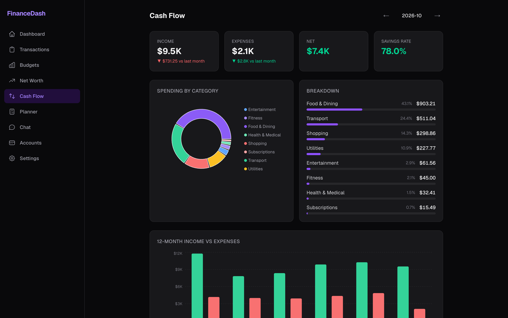
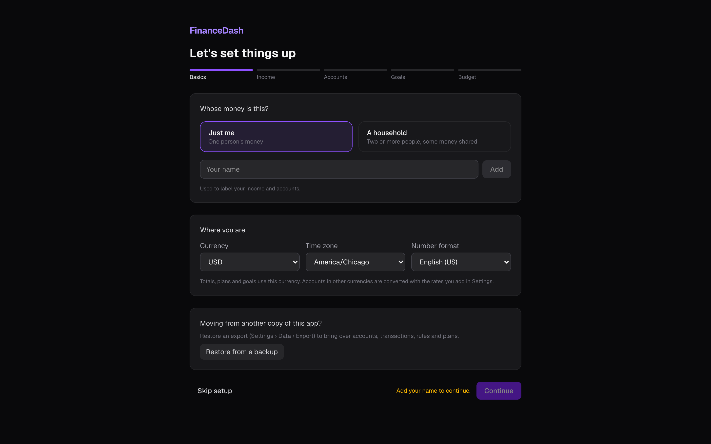

# FinanceDash

A self-hosted personal finance dashboard for one person or a whole household. It covers accounts, transactions, budgets, net worth, cash flow, savings goals and a planner, with an optional AI assistant. It runs on your own computer and keeps your data in a single SQLite file there. There's no subscription and no account to sign up for.

You bring your own keys for the parts that need an outside service: [Plaid](https://plaid.com) for bank sync, and the AI provider of your choice for the assistant: Anthropic, OpenAI, Google Gemini, OpenRouter, or a model running on your own computer with Ollama or LM Studio. Both are optional.



<table>
  <tr>
    <td></td>
    <td></td>
  </tr>
  <tr>
    <td></td>
    <td></td>
  </tr>
  <tr>
    <td></td>
    <td></td>
  </tr>
</table>

<sub>Screenshots use the fictional demo household (`npm run seed:demo`).</sub>

## Features

- **Set up for your household.** Use it on your own or with several people. Each person's income can be a salary, hourly wages, freelance work, equity vests (RSUs) or something else. Pick your own currency, time zone and number format. A setup wizard walks you through it on first start, and everything can be changed later in Settings.
- **Accounts and net worth.** Track checking, savings, investments, retirement, crypto, property, loans and credit cards, with history over time. Accounts can belong to one person or be shared. Accounts in other currencies are converted using exchange rates you add yourself.
- **Transactions.** Add them by bank sync through Plaid, by CSV import or by hand. Rules categorize them automatically.
- **Budgets and cash flow.** Set monthly budgets by category and compare them with what you actually spent.
- **Goals.** Start from a template (emergency fund, home purchase, car, wedding, travel, debt payoff) or make your own. Each goal shows its progress from the accounts linked to it, what it needs each month, and whether you're on track.
  - **Home purchases** include the deposit, closing costs, a cash reserve, the mortgage and the full monthly cost of owning.
  - **Debt payoff** includes interest.
- **Planner.** See how your portfolio could grow, a monthly budget, your plan against your actual spending, and every goal in priority order.
- **Assistant (optional).** Ask questions about your finances in plain English, using the AI provider you choose. It reads your data through tools and can't change anything. Run it on a local model and nothing leaves your computer.
- **Backups.** The app makes a daily SQLite backup on its own, and you can export and import everything as JSON.

## Quick start

Requires [Node.js](https://nodejs.org) 20.12 or later.

```bash
git clone https://github.com/D-Bos-02/financedash.git
cd financedash
npm install
cp .env.example .env
npx prisma migrate dev      # creates the database (dev.db)
npm run dev
```

Open http://127.0.0.1:3000. The setup wizard runs on first start.

### Try it with demo data first

To see the app with a fictional household before entering your own details, load it into a separate database:

```bash
DATABASE_URL="file:./demo.db" npx prisma migrate deploy
DATABASE_URL="file:./demo.db" npm run seed:demo
DATABASE_URL="file:./demo.db" npm run dev
```

Your real data stays in `dev.db`, so this doesn't touch it. Everything in the demo is made up.

## Configuration

Everything is set in `.env`. Only `DATABASE_URL` is required.

| Setting | What it does |
|---|---|
| `DATABASE_URL` | The SQLite file holding your data. Defaults to `file:./dev.db`. |
| `HOST`, `PORT` | Where the app listens. Defaults to `127.0.0.1:3000`, which means only your own computer can open it. See [Security](#security-and-privacy) before changing this. |
| `PLAID_CLIENT_ID`, `PLAID_SECRET`, `PLAID_ENV`, `PLAID_TOKEN_KEY` | Bank sync. Get keys from [Plaid](https://dashboard.plaid.com/developers/keys). Sandbox is free; production needs Plaid's approval. Generate `PLAID_TOKEN_KEY` with `openssl rand -hex 32` and keep it safe. |
| `PLAID_COUNTRY_CODES` | Which countries' banks Plaid offers, e.g. `US,CA`. Defaults to `US`. |
| `LLM_PROVIDER`, `LLM_MODEL` and a provider key | Turns on the assistant. `LLM_PROVIDER` is `anthropic`, `openai`, `gemini`, `openrouter`, `ollama`, `lmstudio` or `custom` (any OpenAI-compatible server, with `LLM_BASE_URL`). Set the matching key (`ANTHROPIC_API_KEY`, `OPENAI_API_KEY`, `GEMINI_API_KEY`, `OPENROUTER_API_KEY`, or `LLM_API_KEY`) and `LLM_MODEL`, which is optional only for Anthropic. Choose a model that supports tool calling. Usage is billed by the provider; local models are free. The comments in `.env.example` list exactly what each one needs. |
| `BACKUP_DIR` | Where daily backups go, e.g. a folder that syncs to cloud storage. Defaults to `./backups`. |

**Setting up Plaid:** the setup wizard and the Accounts page walk you through it. You create a free Plaid account, paste your keys, and get the exact lines to add to `.env`, including a freshly generated `PLAID_TOKEN_KEY`. Start in Sandbox with Plaid's test banks, which don't count toward any limit on real connections, then request Production access in the Plaid dashboard to connect your real bank. Plaid's free trial allows 10 real bank connections in total, and removing one doesn't free its slot (each login to a bank counts once, however many accounts it has), so try everything in Sandbox first. Without Plaid, add accounts by hand and import transactions from your bank's CSV export.

With `npm run dev`, changes to `.env` are picked up within a few seconds. With `npm start`, restart the app after changing it.

## Security and privacy

- **Your data stays on your computer.** It lives in the SQLite file and leaves your machine in only two cases:
  - **Bank sync:** if you turn it on, your bank data comes to you through Plaid.
  - **Assistant:** if you turn it on, the figures it needs to answer a question are sent to the AI provider you chose. With Ollama or LM Studio the model runs on your own computer, so nothing is sent anywhere.
- **There is no login.** That's why the app only accepts connections from your own computer by default (`HOST=127.0.0.1`).
- **Opening it to your network is risky.** Setting `HOST` to `0.0.0.0` or your computer's network address (for example, to use it from your phone at home) lets **anyone on the same network see and change all of your financial data**. The app prints a warning when it starts this way and shows a warning bar on every page. Only do it on a network you trust, never on public Wi-Fi, and don't deploy this to a public server.
- **Bank access tokens are encrypted** in the database with `PLAID_TOKEN_KEY`.
- **Keep your data out of git.** `.env`, `*.db` files and the `backups/` folder are already in `.gitignore`, so keep them there.

## Moving and backing up your data

- **Backups:** the app copies the database once a day to `BACKUP_DIR`, keeping the last 30. You can also make one from Settings.
- **Export and import:** Settings › Data exports everything as JSON. Import it on another computer, or choose *Restore from a backup* in the setup wizard.

## Not financial advice

This is a tool for organising your own numbers. Its projections and plans are estimates based on what you enter. They aren't financial, tax or investment advice. Check anything important with a qualified professional.

## Development

```bash
npm test             # unit tests (vitest)
npm run lint
npx tsc --noEmit     # typecheck
npm run build
```

Built with Next.js, React, Prisma (SQLite), Tailwind CSS and Recharts. Logic lives in `lib/` with tests beside it, UI in `components/`, and pages and API routes in `app/`. Run `npx prisma generate` after changing `prisma/schema.prisma`. If you're working on it with an AI coding agent, read `AGENTS.md` first.

Contributions are welcome. Please keep personal data out of code, tests and commits.

## License

[MIT](LICENSE)
